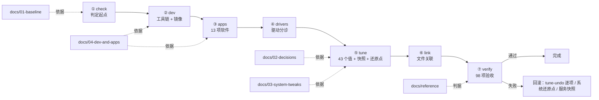

# Windows 新装优化

> 一台刚装好系统的 Windows，从「能开机」到「能干活、能打游戏、改坏了能退回去」。
>
> 这个项目只做一件事，但分两层写：**能跑的脚本**（`scripts/`）与**为什么这么改的判据**（`docs/`）。
> 两层的顺序完全一致 —— 阶段编号就是配置顺序，也是文档编号。

## 结构：三层，各管一件事

```text
skills/windows-fresh-setup/
├── SKILL.md                ← AI 执行入口（协议、判断规则、不该做什么）
├── README.md               ← 你在这里：装配线、命令、验收
├── apps.json               ← 软件清单（13 项：来源 / 校验 / 关联）
├── presets/                ← 预设（TrafficMonitor 配置）
├── scripts/                ← 可执行层：setup.ps1 + 17 个可单跑的工具
│   └── lib/tune-core.ps1   ← 纯函数（DWORD 渲染、build 门控），有自测
├── docs/                   ← 原理层：按配置顺序编号的四份正文
│   ├── 01-baseline.md          起点判定与环境事实
│   ├── 02-decisions.md         哪些改动值得做（证据 → 决定表）
│   ├── 03-system-tweaks.md     45 个调优值：正确值 / 判据 / 怎么验
│   ├── 04-dev-and-apps.md      开发环境与 13 项软件
│   ├── 05-params.md            参数速查（七个阶段的参数、脚本用法、依赖）
│   └── reference/              跨阶段参考
│       ├── pitfalls.md         38+ 条陷阱：症状 / 根因 / 判据 / 做法
│       └── audit-criteria.md   判定原则 + 18 项判据 + 只读命令清单
└── games/                  ← 按游戏的可回退优化（当前 CS2）
    ├── README.md · AGENTS.md
    └── cs2/{README.md,scripts/}
```

**为什么这样分**：脚本回答"怎么改"，`docs/` 回答"凭什么这么改、改完怎么验"，`games/` 是同一套方法在具体游戏上的落地。
三者编号对齐，读文档和读代码不会迷路。

## 装配线



## 阶段 ↔ 命令 ↔ 文档 ↔ 验收

| 阶段 | 命令 | 依据 | 产物 / 验收 |
|---|---|---|---|
| `check` | `setup.ps1 -Phase check` | [01-baseline](docs/01-baseline.md) | 环境体检报告；缺什么一目了然 |
| `dev` | `setup.ps1 -Phase dev` | [04-dev-and-apps](docs/04-dev-and-apps.md) | 工具链 + 国内镜像 + PATH |
| `apps` | `setup.ps1 -Phase apps` | [04-dev-and-apps](docs/04-dev-and-apps.md) | 13 项软件，逐项回读 + SHA256 |
| `drivers` | `setup.ps1 -Phase drivers` | [05-params](docs/05-params.md) | 驱动分诊与失败设备重置 |
| `tune` | `setup.ps1 -Phase tune` | [02-decisions](docs/02-decisions.md) · [03-system-tweaks](docs/03-system-tweaks.md) | 43 个值 + 快照 + 还原点 + 逐项撤销脚本 |
| `link` | `setup.ps1 -Phase link` | [04-dev-and-apps](docs/04-dev-and-apps.md) | 文件关联（含便携程序的可见性处理） |
| `verify` | `verify-env.ps1` | [03-system-tweaks](docs/03-system-tweaks.md) · [audit-criteria](docs/reference/audit-criteria.md) | **98 项 / 0 失败** |
| 游戏 | `games/cs2/scripts/*.ps1` | [games/](games/README.md) | 只读体检 + 可回退应用 |

## 三步开始

```powershell
# 1) 预演：看清楚会改什么，不写入任何东西
pwsh -File skills/windows-fresh-setup/scripts/setup.ps1 -Profile full -WhatIf

# 2) 执行（tune 需要管理员；会先建还原点与快照）
pwsh -File skills/windows-fresh-setup/scripts/setup.ps1 -Profile full

# 3) 验收（改完必须重启再验，PATH / 输入法 / MMCSS 都在登录时重建）
pwsh -File skills/windows-fresh-setup/scripts/verify-env.ps1
```

`-Profile` 三档：`minimal`（只体检与调优）、`dev`（加工具链）、`full`（全套）。也可以按 `-Phase` 单步跑。

## 验收基线

```
verify-env.ps1   98 项 / 0 失败 / 1 信息项（SSH 无密钥，属正常）
  tweaks    49   注册表值与结果型检查（RegBack、MMCSS 驱动、遥测任务、防火墙）
  system     7   页面文件、完整性标签、计划任务等系统健康
  runtimes   6   VC++ 2010/2012/2013 ×x86/x64
  archives   2   压缩工具
  hygiene    1   双宿主解析（PS7 + 5.1）
  languages 30   Python/Node/Go/Rust/.NET/C++/Java 等
```

**判据是结果，不是开关**：`EnablePeriodicBackup=1` 不等于有备份（查 `RegBack` 字节数）；MMCSS 那几个值只有在驱动 `RUNNING` 时才有效（查 `sc query`）。

## 三条纪律

1. **不碰按需启动的服务** —— 只改 `tune` 列出的值；服务裁剪是负收益，理由见 [02-decisions](docs/02-decisions.md) 的「不要做」表。
2. **动系统前先拍快照** —— 服务快照 + 系统还原点（绕过 dedupe 限制）+ 逐项撤销脚本，三件一起才是回滚。
3. **改完必须重启再验证** —— 不重启就验收会把「还没生效」当成「改坏了」。

## 维护约定

| 变化 | 要同时改 |
|---|---|
| 新增一条调优 | `scripts/lib/tune-writes.ps1` 加一条写入 + `scripts/verify-env.ps1` 的 `$tweaks` 加一条检查 + `docs/03-system-tweaks.md` 一行；三者不同步时 `check-tune-consistency.ps1` 直接失败 |
| 新增一个软件 | `apps.json` + `docs/04-dev-and-apps.md` 的清单表 |
| 新增一个游戏 | `games/<game>/`（照 [games 模板](games/README.md)）+ 更新索引 |
| 发现新的坑 | `docs/reference/pitfalls.md` 一行（症状 / 根因 / 判据 / 做法） |

**文档里的值必须与代码一致**；不一致时以代码为准并立即修文档（`verify-env.ps1` 会替你发现这件事）。

## 去哪看细节

- **参数、依赖、脚本用法** → [docs/05-params.md](docs/05-params.md)
- **为什么这么做、别的方案为什么不做** → [docs/02-decisions.md](docs/02-decisions.md)
- **撞墙了** → [docs/reference/pitfalls.md](docs/reference/pitfalls.md)（先查表，别猜）
- **什么叫"真的生效了"** → [docs/reference/audit-criteria.md](docs/reference/audit-criteria.md)
- **让 AI 按协议执行** → [SKILL.md](SKILL.md)

---

<p align="right"><sub><a href="../../README.md">← 笔记本目录</a> · <a href="SKILL.md">SKILL.md</a> · <a href="docs/03-system-tweaks.md">调优清单</a> · <a href="games/README.md">游戏优化</a></sub></p>
