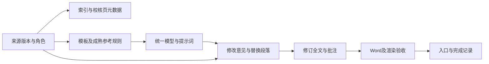

# 来源更正与错误产物清理

材料由“成熟参考”改为“待改稿”，会同时改变规则来源与审阅对象。修复必须沿依赖展开；只改姓名、目录或封面，会留下错误规范和失效证明。

## 1. 先停用受影响的派生产物

记录本次角色更正：稳定来源 ID、旧角色、新角色、用户确认依据及生效的角色版本。暂时将受影响规范、意见、全文和完成记录标为失效，防止继续调用；不改动用户原件。



OCR 识别行依赖来源内容，规则和建议还依赖角色。两种依赖要分别判断，不能全删重来，也不能全部沿用。

## 2. 展开影响清单

| 对象 | 检查及处理 |
| --- | --- |
| 用户原件、源图 | 保留；核对指纹，不因认错用途而移动或改写原件 |
| 原始 OCR、识别行与坐标 | 内容指纹相同且输出可用时复用；角色元数据单独更新 |
| 校核页 | 保留正确转录，重写角色说明、用途及受影响分析 |
| 来源索引、合集、清单和逐页状态 | 更新分组、页序映射、计数和链接；移动不当成新增 |
| 规则、混合模型、统一模型和提示词 | 撤销失效来源，按新 T/R 原件重建；D 排出规范池 |
| 错误对象的意见、替换段落和完整稿 | 撤销有效性；按纠错授权删除错误生成结果，对新目标重做 |
| 批注、PDF、预览图、目录及渲染缓存 | 随所属错误稿成组处理，不能继续作为当前验收证据 |
| 生成器、配置及硬编码参数 | 改成精确来源映射，清理会重生错误稿的入口 |
| 审阅记录及完成证明 | 撤销旧对象或旧输入的有效性，为当前交付重验 |
| README、交付链接和状态说明 | 只指向当前有效产物，防止读者继续取得错误结果 |

检索旧来源 ID、旧角色、对象别名、输出名及脚本参数，但不能把子串搜索结果直接作为批量替换或删除依据。对每个实际文件登记保留、迁移、重建或删除的去向，见[项目建档与修复清单](../模板/项目建档与修复清单.md)。

## 3. 规范池去除目标污染

新 D 之前曾被当作 R 时，应逐条撤销由它支持的规则，再从当前 T/R 验证或重建；不能仅在模型首页将 R 改成 D，而让原规则原样保留。

旧 D 恢复为 R 时，只能使用它的成熟原件及正确转录。此前对它生成的改写、意见或完整稿不能反过来成为成熟参考。重复出现的事实、结论或特殊条件尤其要检查是否来自旧对象。

```text
当前规范来源 ⊆ 本次有效模板与成熟参考原件
当前规范来源 ∩ 本次待改稿 = 空集
当前产物的角色版本 = 本次有效角色版本
当前产物不依赖已撤销的生成稿
```

## 4. 删除错误结果的边界

用户要求删除错误处理结果时，清理精确列出的 AI 生成错误正文、意见、完整稿及其派生缓存。正确原始提取、用户原件和仍有效的转录不属于错误结果。

清理前记录本地操作元数据：文件路径、旧指纹、处理类型、原因及替代产物；记录本身不嵌入错误正文。不要用“保留历史”让错误稿与有效稿并排成为默认入口，也不要借此清理无关文件、回收站或 Git 历史。

删除后重新扫描。旧路径不再出现只证明该路径已移除；还须结合逐文件去向，在本次授权生成目录内检索旧指纹、对象角色及改名产物，排除错误正文换名残留，并区分合法保留的原始提取与校核转录。相同路径已经重建时，检查新指纹、当前对象及来源依赖，不能只看路径存在与否判断清理完成。

## 5. 复用与重新验收分别证明

- 原件内容未变：比对来源 SHA-256。
- 原始 OCR 未改：比对识别行、坐标或整份原始输出指纹；元数据变更另列。
- 数量没有重复：分别复核图片、逻辑页、去重文件及 OCR 记录。
- 新目标已处理：重新检查目标原文、意见、完整稿和批注，不能沿用旧对象数量。
- 错误产物已清理：逐文件去向清单与当前目录重新扫描对应。
- 新交付有效：链接、语义、Word、目录及最终渲染都绑定当前输入版本。

完整指纹和操作清单留在本地。对外复用只保留通用字段，不能把真实来源指纹、内部路径及个案数据当作指南的验证样例。

## 6. 完成修复的条件

旧结果失效、当前角色明确、目标未参与建立规范、正确转录得以保留、失效规则已重建、错误生成器不再恢复旧稿、入口只指向当前产物。完成记录必须覆盖这次更正后的实际输出，不能把“已删除旧文件”当成“已完成新目标”。
